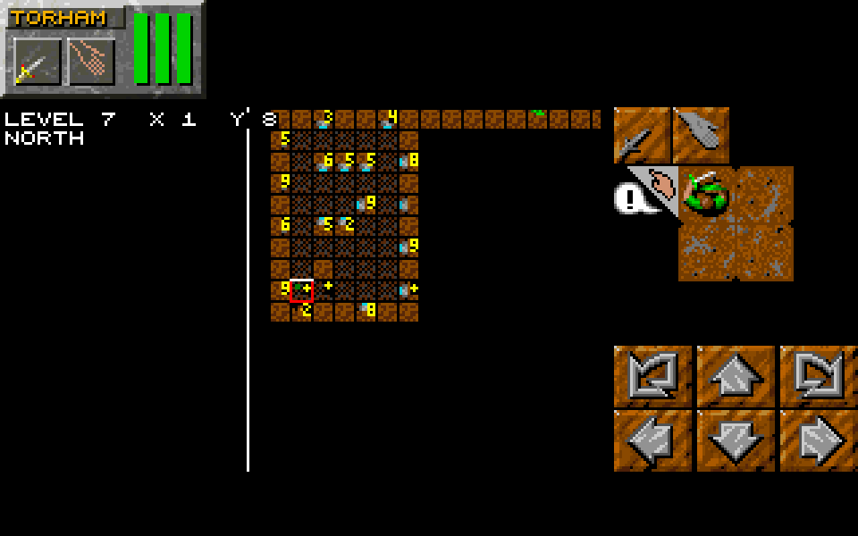
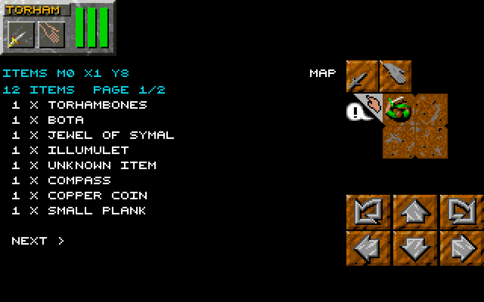
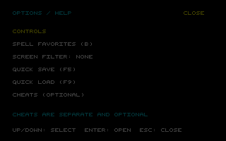
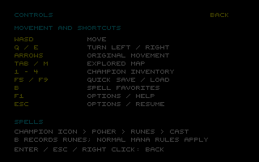
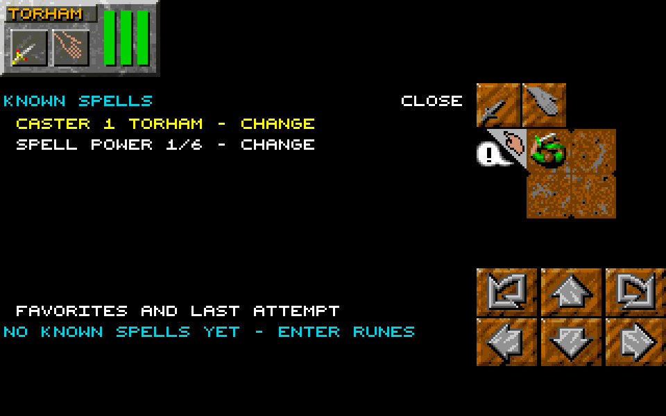
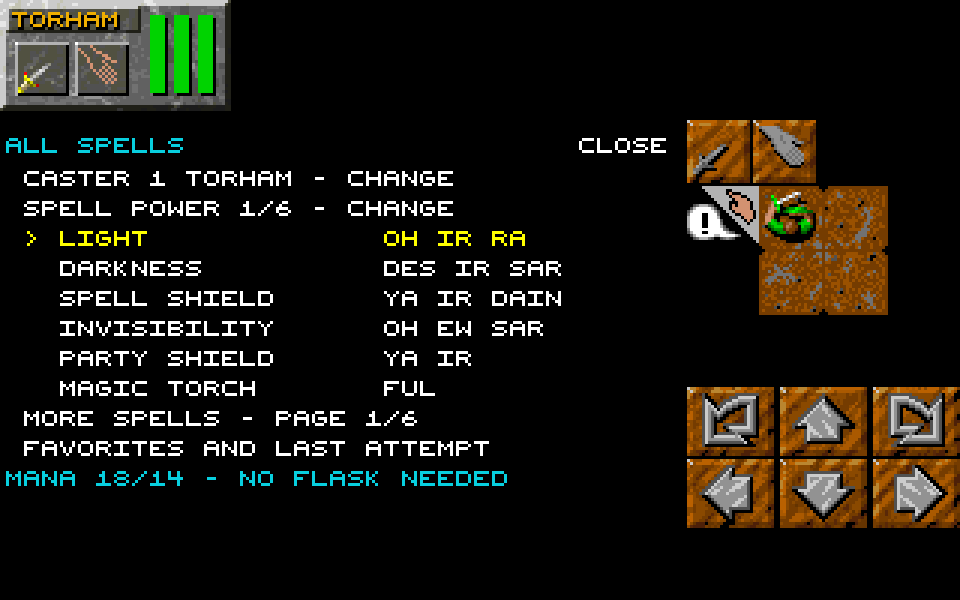
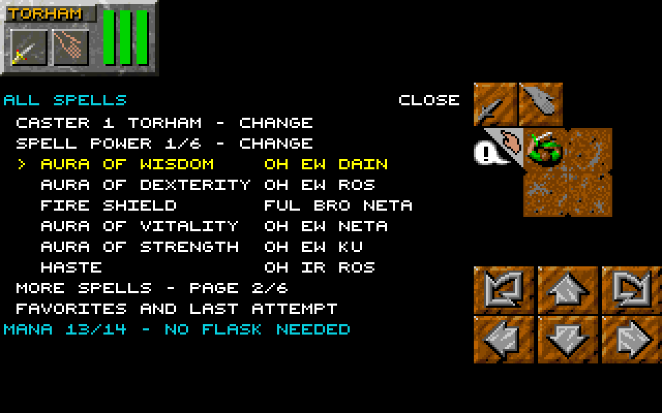
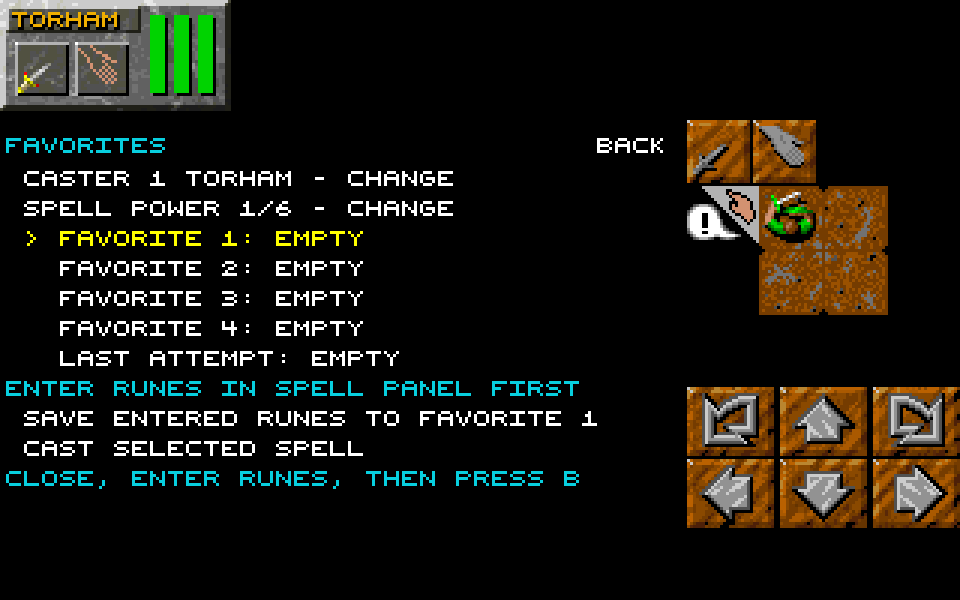

# DM2Mac: Dungeon Master II for macOS, Linux, and Windows

DM2Mac is a native C11 and SDL3 port of **Dungeon Master II: The Legend of Skullkeep** (PC DOS, 1995) for macOS,
Linux, and Windows. It is a recompilation: Ghidra decompiled the original DOS program to C, the game was rewritten
in C11 with SDL3 from that code, and the result runs natively without DOSBox. This fork builds on
[Peter Kmet’s DM2Mac port](https://github.com/peterkmet/dm2mac). See [what this fork adds](#what-this-fork-adds)
for gameplay videos.

<p align="center">
  
  
</p>

## What you need

Your own copy of the PC DOS version of Dungeon Master II (English): its folder, its ZIP archive, or its CD image
(`.iso`, `.img`, `.bin`). This repository and the release contain no game files. Other versions (Amiga, FM Towns, other
languages) do not work.

## Play

The download below is for the upstream port. Follow the [build instructions](docs/development.md) to run this
fork and try the features in the gameplay demos.

1. Download the [latest upstream release](https://github.com/peterkmet/dm2mac/releases/latest): `DM2Mac-macos-arm64.zip` or
   `DM2Mac-windows-x64.zip`. Extract it.
2. Copy your game (the folder, the ZIP archive, or the CD image) into the extracted `DM2Mac` folder.
3. Start the game:
   - **macOS:** In Terminal, remove the quarantine attribute in the `DM2Mac` folder:

     ```sh
     xattr -dr com.apple.quarantine DM2Mac.app
     ```

     Then double-click `DM2Mac.app` in the Finder.

   - **Windows:** Run `dm2.exe`. If SmartScreen warns about an unknown publisher, select "More info", then
     "Run anyway".

On first startup the game checks your files and copies the 10 files it needs into `game/` in the `DM2Mac` folder. If
a file is missing or wrong, a message names it. The game keeps all its files in `game/`: the game files, your saved
games in `game/DATA`, the settings, and the messages in `dm2.log`. To remove the game, delete the `DM2Mac` folder.

### Linux

Linux has no release zip. Build the game from the source ([Linux build](docs/development.md#linux-build)). Copy
your DOS game folder, ZIP archive, or CD image next to `build/dm2`, then run `build/dm2`. The messages go to the
terminal.

## Modes

On startup you choose how to play:

- **Vanilla** runs with the original game behavior.
- **Advanced** (the default) adds these controls and options:
  - WASD movement and Q/E turning;
  - an automap (Tab) of the squares you have seen;
  - quick save (F5) and quick load (F9);
  - a spell list (C) and a separate optional cheat screen (X);
  - screen filters (Scale2x, Scale3x, xBRZ 2x/3x/4x), 4:3 aspect correction and scanlines.

In both modes the mouse and the arrow keys work as in the original game. The keys, the cheats, and the screen filter
are in the [advanced mode section of the Player manual](docs/manual.md#advanced-mode).

## What this fork adds

Choose **Advanced** on startup to use the features below. The upstream port already provides the original rune
panel, an explored-area automap, quick saves, the free-cast cheat catalog, and Scale2x/3x filtering. This fork
builds on those features with new ways to cast, explore, manage inventory, and recover a game.

### Watch the gameplay demos

Each link opens a short MOV recorded in Advanced mode. The clips show the controls in use and the result on
screen. Download a clip if your browser does not preview MOV files.

| Gameplay demo | What changed |
| --- | --- |
| [01 · Party attack](captures/feature-tweets/01-attack-all.mov) | Click an enemy to have ready champions attack together. The crossed-swords cursor dims during recovery, and damage numbers appear over the target. |
| [02 · Highlight reachable objects](captures/feature-tweets/02-highlight-reachable-objects.mov) | Hold **Ctrl** to outline nearby objects you can interact with. Cyan marks controls such as levers, yellow marks receptacles such as keyholes, and white marks objects you can pick up. |
| [03 · Follow the runes](captures/feature-tweets/03-follow-the-runes.mov) | Enter runes by hand. The panel highlights possible next runes and names the spell when you complete a recognized combination. |
| [04 · Cast by name](captures/feature-tweets/04-cast-by-name.mov) | Press **C**, choose a caster and power, and cast from the spell list. The cast uses the champion's mana and skill as usual. |
| [05 · Known spells or the full catalog](captures/feature-tweets/05-known-spells-or-full-catalog.mov) | Change **Spells Shown** in Options/Help to keep spell discovery or browse the full catalog. The setting also controls rune hints. |
| [06 · Read rune syllables](captures/feature-tweets/06-rune-syllables.mov) | Hover over a rune to read its syllable, such as **FUL**. Move the pointer away to see the symbol again. |
| [07 · Save and cast a favorite](captures/feature-tweets/07-save-and-cast-a-favorite.mov) | Press **Alt+C**, then one of **Alt+1**–**Alt+4** to save the entered runes as one of four favorites per champion. With an empty rune tray, the same shortcut casts the favorite. |
| [08 · See why a spell failed](captures/feature-tweets/08-why-a-spell-failed.mov) | Casting feedback explains how much mana is missing, suggests an affordable power when available, or tells you when the caster needs an empty flask. |
| [09 · Ordinary and cheat casting](captures/feature-tweets/09-ordinary-vs-cheat-casting.mov) | **C** opens the ordinary spell list. **X** opens optional cheats, including the upstream free-cast catalog. The two menus make it clear which rules apply. |
| [10 · Add map notes](captures/feature-tweets/10-map-notes.mov) | Double-click an explored square, type a note, and press **Enter**. Click the cyan pin to read the note later. |
| [11 · Find floor items on the map](captures/feature-tweets/11-floor-items-on-the-map.mov) | A yellow plus marks an explored square with items. Click it for names and quantities. The marker disappears when you pick up the last item. |
| [12 · Browse the automap](captures/feature-tweets/12-explore-the-automap.mov) | Pan with the arrow keys, zoom around the pointer with the mouse wheel, and browse visited floors with **Q** and **E**. **Space** recenters on the party, and Options/Help has a map legend. |
| [13 · Compare gear and pin skills](captures/feature-tweets/13-compare-gear-and-pin-skills.mov) | Pick up an item with inventory open to see how its stats compare with equipped gear. The panel also shows bonuses. Put the item down and pin the skills panel for quick reference. |
| [14 · Open inventory while holding an item](captures/feature-tweets/14-inventory-via-champion-name.mov) | Click a champion's name while carrying an object on the cursor. Their inventory opens and you can place the object in the slot you choose. |
| [15 · Use the keyboard shortcuts](captures/feature-tweets/15-keyboard-shortcuts.mov) | **Ctrl+S** opens the disk menu, **Ctrl+R** rests, and **Ctrl+Q** starts the quit sequence. **Esc** backs out of menus and opens Options/Help in the dungeon view. |
| [16 · Choose classic stepping](captures/feature-tweets/16-classic-stepping.mov) | Turn **Smooth Stepping** off for direct, square-to-square movement. The clip compares both settings from the same save. |
| [17 · Turn off bump damage](captures/feature-tweets/17-no-bump-damage.mov) | Enable **No Bump Damage** in **X**. The same wall still stops the party, and the champions keep their health. |
| [18 · Recover from a damaged quick save](captures/feature-tweets/18-save-slots-and-quick-save-recovery.mov) | The game reports a damaged quick save when you press **F9**. Use **Ctrl+S** and **Load** to recover from a separate numbered slot. |
| [19 · Change the display](captures/feature-tweets/19-display-options.mov) | Compare original pixels, 4:3 aspect correction, xBRZ smoothing, and scanlines on the same inventory screen. |

## Advanced mode improvements

Advanced mode keeps the real-time dungeon game and adds tools for navigation, repeated actions, recovery, and learning the controls. Choose **Advanced** on startup (the default), or start with `--mode advanced`. Optional cheats start off in a new game.

The improvements include automap item inspection, spell favorites, in-game help, inventory comparison, and safer recovery and input handling. For exact rules and edge cases, see [Advanced mode rules](docs/rules/advanced-mode.md) and the [Player manual](docs/manual.md#advanced-mode).

### Find items on the automap

Press **Tab** or **M** in the dungeon view to open the automap. Game time stops while you inspect it. The map normally shows explored squares; drag with the left mouse button or use the arrow keys or **W/A/S/D** to look around, press **Q**/**E** to look at the other levels you have visited, and press **Space** or reopen the map to center on the party again. The position readout gives the level, coordinates, and facing direction. Scroll the mouse wheel over the map to zoom between 1×, 2×, and 3× around the pointer. Reopening the map restores 1×; the readout and item list keep their normal text size.



*A single yellow plus identifies each tile containing loose items, regardless of quantity. This demonstration uses Reveal map, so it includes squares beyond normal exploration.*

The markers answer a practical question: where did I leave that pile? They reflect the current dungeon state, including alcove items and items without map graphics. Containers count as one item; their contents, champion and creature inventories, missiles, and effects are excluded. Moving creatures and merchants are not shown as map creatures.

Every tile containing items has one yellow `+`. Click the tile to see item names and quantities. Exploration remains meaningful: without Reveal map, items appear only on explored squares. Turning Reveal map on does not permanently mark those squares as explored.

#### Inspect a pile without walking to it

Short-click a square containing items to open its list. Matching names are grouped with quantities, and the subtitle reports the exact total. Large collections span multiple pages.



*The selected square contains ten items. Page 1 of 2 lists eight groups, including a compass, copper coin, and small plank. NEXT opens the remaining groups.*

Use **Left/Right**, **A/D**, or **PREVIOUS/NEXT** to change pages. Click **MAP**, press **Esc**, or right-click to return to the map; **Tab/M** close the automap from either view. Inspection reads the current items whenever drawn, so collecting or dropping items changes the next view without a separate saved item history.

### Ordinary options and help in one place

Press **F1**, or **Esc** in the dungeon view, to open **Options/Help**. This pauses game time and provides controls, spell favorites, screen filtering, quick save/load, and an explicit entry to optional cheats.



*Options/Help, enlarged 3× with increased text brightness for readability. This earlier capture predates the SPELLS SHOWN, aspect, scanlines, and SMOOTH STEPPING rows described below.*

F1 also opens help from inventory, sleep, and pause. Save and cast actions require the dungeon view; name entry, recruiting, and dialogs retain their original input behavior. This avoids turning a typed name into a movement or save command.



*Controls, enlarged 3× with increased text brightness. This earlier capture labels B as favorites; the current C screen opens the spell list with favorites available inside it.*

| Key | Action in the dungeon view |
| --- | --- |
| W / A / S / D | Move |
| Q / E | Turn left / right |
| Arrow keys | Original movement controls |
| Tab / M | Open the automap |
| F5 / F9 | Quick save / quick load |
| C | Open the spell list (favorites inside it) |
| Alt+C, then Alt+1–Alt+4 | Record entered runes as a favorite, or cast a favorite |
| F1 / Esc | Open Options/Help |
| X | Open optional cheats |

Tab or Esc closes an open inventory, except while editing a name; while recruiting, Esc cancels and sends the candidate back to the mirror. Advanced shortcuts require an idle party: inspection holds, champion dragging, and push mode prevent dungeon shortcuts from firing.

### Spells: cast by name, learn runes, and save combinations

Press **C** in the dungeon view, or choose **SPELL LIST (C)** in Options/Help. The list pauses game time while you browse. Each spell shows its name and the rune names after the power rune; the caster and power are separate choices at the top.

#### Known spells or the full spell catalog

**Options/Help → SPELLS SHOWN** switches between **KNOWN SPELLS**, which lists spells you have cast, and **ALL SPELLS**, which reveals the full catalog. The same setting controls spell-name hints during manual rune entry and is remembered in `SETTINGS.TXT`.



*With no known spells, the list directs you to enter runes. You can learn through ordinary casting, or choose All spells to browse the catalog.*



*LIGHT is selected at power 1/6 for Torham. MANA 16/14 means the cast needs 16 mana while this caster currently has 14; it does not mean 16 mana remains. NO FLASK NEEDED identifies a spell that does not create a potion.*

The list displays six spells per page. **Left/Right** or **A/D** change pages, and **MORE SPELLS** advances to the next page, wrapping around after the last. **Up/Down** or **W/S** select a row; **Return** activates it. The selected spell is yellow and marked with `>`.



*Page 2 shows another six spells, with rune combinations alongside the names. The footer previews the selected spell's requirements.*

#### Choose a caster and power, then cast

1. Activate **CASTER … CHANGE** to cycle champions. Choose a living champion who is ready to cast.
2. Activate **SPELL POWER … CHANGE** to cycle power 1 through 6. Check the updated mana preview; reduce power if the caster cannot afford the spell.
3. Select a spell and check its flask requirement. Potion spells require an empty flask in one of that caster's hands; the status reports **FLASK READY** or **FLASK MISSING**.
4. Activate the selected spell to cast. With the mouse, the first click on a different spell selects it and shows its costs; a second click casts. Clicking an already selected spell activates it immediately. With the keyboard, Return activates the selected spell.

The list uses normal rune entry and casting: mana costs, skill checks, failures, experience, flask requirements, and action delays apply. Merely showing **All spells** does not grant free casting. The game reports why an attempt cannot start, such as **CHOOSE A LIVING CASTER**, **CASTER BUSY - WAIT AND TRY AGAIN**, or **NOT ENOUGH MANA - LOWER SPELL POWER**. If runes are already entered, close the list and cast or remove them first.

Press **C** to close the list. **Esc** or right-click closes the main spell list; from favorites, either returns to the list.

#### Rune hints while casting manually

Hovering over a grey rune button replaces its symbol with a compact syllable label (for example `FUL`); moving away restores the symbol.

The original spell panel remains available: select a champion's spell hand, enter a power rune, then enter the spell runes. In Advanced mode, the spellbook identifies possible next runes for the current prefix. When the entered combination completes a visible spell, a cyan message names its runes and spell.

With **Known spells**, hints respect discovery and name only known spells. With **All spells**, hints can identify every spell; if no spell begins with the entered combination, the message says **NO SPELL HAS THESE RUNES**. A power rune by itself does not produce a spell-name message because it can begin every spell.

#### Four favorites per champion, plus the last attempt

Choose **FAVORITES - KEYS 1-4 SET THE SPELL** from the list. Each champion has four saved combinations and a separate **LAST ATTEMPT** entry. Unknown rune combinations can be recorded too.



*Empty favorites show the next step: enter runes in the normal spell panel before saving a combination. This capture demonstrates the initial state, not a successful recorded cast.*

To record a favorite, mark a spell in the list and press **1**–**4**: it becomes that favorite of the shown caster at the shown power, and the list shows the number in front of the spell. To record runes you entered by hand (also an unknown combination), hold **Alt**, press **C**, then **1**–**4** in the dungeon view; the same keys with no runes entered cast that favorite. Recording costs no mana. **Backspace** on a favorite row of the favorites page empties it.

To replay later, begin with an empty rune tray, choose the champion and power, select the saved favorite, and activate **CAST SELECTED SPELL**. The mana preview and flask status help check readiness. Replay uses the normal casting path; it cannot bypass mana costs, cooldowns, failure rolls, or potion-flask requirements. An empty slot reports **EMPTY SLOT - SET A SPELL FIRST**.

**LAST ATTEMPT** records failed attempts as well as successful ones. It is a separate automatically maintained entry; select one of the four favorite slots when recording manually. A potion cast without a flask retains its paid runes as in ordinary casting. Favorites persist in the optional `FAVS` save block; new games and older saves without that block start empty.

#### Free casting is a separate cheat

The **X → SPELLS - FREE CAST CHEAT** catalog casts at maximum power without mana cost or a failure roll and grants no experience. Flask requirements and action delays still apply. Use the ordinary C list or favorites when you want normal casting rules.

### Recover quickly and pause when focus changes

**F5** writes `QUICK.DAT`; **F9** restores it without a slot-selection dialog. The quick save lives in the selected saves directory (`--saves DIR`), otherwise in the game data's `DATA` folder. It is separate from numbered save slots. Advanced startup and party-death recovery offer the quick save explicitly, even when no numbered slot exists.

Messages distinguish a successful save/load from a missing quick save, damaged quick save, or inability to save. Keep numbered slots when you want multiple recovery points: each quick save replaces the single quick-save checkpoint. Explored squares, cheat settings, and recorded favorites persist with saves.

Losing focus or minimizing automatically latches an Advanced pause and clears queued input and held interactions. Returning focus alone leaves the game paused. Press a fresh **Return** to resume, then press movement keys again. This prevents old queued movement or mouse holds from continuing when you return to the game.

### Choose animated or direct stepping

**Options/Help → SMOOTH STEPPING** lets you choose how walking between dungeon squares looks:

- **On** (the default): retain the intermediate walking frames for an animated transition between squares.
- **Off**: skip the intermediate walking frames for a quicker, direct step, similar to Dungeon Master I or Eye of the Beholder.

With smooth stepping off, movement is more responsive: the destination is drawn at once, step sounds play with it, and transition sounds are synchronized with the arrival view. Collision checks and champion movement cooldowns still apply in either setting. This changes the presentation of walking rather than removing movement restrictions. The choice persists in `SETTINGS.TXT`, so you do not need to reset it each session. Walking animation is separate from the smooth projectile flight described below.

### More comfortable movement and presentation

Hover over an enemy: crossed swords mark a creature that the party can attack, bright when a champion is ready and grey while the party recovers. A left click orders one party volley: each ready champion repeats their last chosen melee or shooting action, or uses a basic one, with the normal range, formation, ammunition, stamina, and cooldown rules. Spells and throwing are excluded, and the leader hand must be empty. A damage star over the creature shows each hit; projectile damage appears on impact. The exact rules are in [Party attack](docs/rules/advanced-mode.md#party-attack).

Held movement repeats only while the game waits for input, allowing the party to stop when the key is released. Larger champion status areas make inventory interaction easier: with an empty leader hand, clicking outside the hand slots opens inventory; with an object held, it places that object into the champion's inventory.

Advanced mode also extends the display of a successful damage star by one game step, without changing action delays. Projectile rendering interpolates flight at timer frequency while the party view stays still; simulation movement and combat rules retain their original steps. A still screenshot cannot demonstrate either timing improvement.

Screen filters, 4:3 aspect correction, and scanlines provide presentation choices. Their settings persist in `SETTINGS.TXT` beside `QUICK.DAT`. Startup filter overrides from `--filter` or `DM2_FILTER` take precedence over the stored filter. Advanced mode also makes antidotes reliably cure poison.

### Inventory at a glance

An object held on the eye, or in the leader hand, shows its details in the open inventory. In Advanced mode the gauges compare it with the item the champion wears in that slot or holds: green for more, red for less. Lines below list bonuses (mana, statistics, skills) and the exact armor, strength, throw, shoot, extra and weight values, each with the difference. Clicking the food/skills panel pins the skills panel in place of the food and water gauges. See [Item compare](docs/rules/advanced-mode.md#item-compare).

### Optional cheats remain explicit

**X** opens seven independent switches: full light, immortality, endless food and water, one-hit kills, walking through walls, Reveal map, and no bump damage (collisions with walls, doors, and objects cost no health). New games start with all seven off; saves restore their stored values. The cheat screen also contains the free spell catalog, which bypasses mana cost and the failure roll and grants no experience, but still requires a flask for potion spells and retains action delay.

These additions belong to Advanced mode. Vanilla retains the original behavior, and turn-based mode has its own documented control model.

### Screenshot notes

The automap and item-list images are game captures retained from the improvement documentation session. The map and item-list captures use an item-rich demonstration state; the revealed map is illustrative rather than a claim about normal starting exploration. The options, controls, and spell screens are rendered from the current game UI and original game assets in an isolated test session, using the VGA palette conversion and 3× pixel scaling. Spell screenshots use a new-game demonstration state; All spells is enabled for the catalog examples. They document visible UI; save recovery, focus handling, spell replay, and animation behavior above are described from the repository rules rather than asserted as verified by these still images.

## Let an LLM play

On macOS and Linux, a program such as an LLM can play the game turn by turn over a Unix socket. In the turn-based
mode the game time stops between requests; each request is one turn, and the reply gives the state and the view as
JSON. Build the game first (see [Development](docs/development.md)), then:

```sh
build/dm2 --mode turnbased &
uv run dm2-play --brief get_state
uv run dm2-play act move_forward
```

[Control socket](docs/llm/control-socket.md) has the start, `dm2-play`, and the protocol;
[Turn-based mode](docs/llm/turn-based.md) has the turns, the actions, and the reply fields. [LLM runs](docs/llm/llm-runs.md)
describes playthroughs with a coordinator agent and player agents, and the
[LLM playbook](docs/llm/llm-playbook.md) is the page the player agent reads.

## For developers

DM2Mac is a C11 and SDL3 reimplementation of `SKULL.EXE`, built from its own Ghidra decompilation and checked
against the original in an emulator. Build instructions and tests are in [Development](docs/development.md); the documentation index is
[docs/README.md](docs/README.md).

## Acknowledgements

- [SDL3](https://github.com/libsdl-org/SDL): windowing, input, and audio output.
- [Nuked-OPL3](https://github.com/nukeykt/Nuked-OPL3) by Nuke.YKT: OPL3 emulation for the music.
- [tinf](https://github.com/jibsen/tinf) by Jørgen Ibsen: ZIP decompression.
- [xBRZ](https://sourceforge.net/projects/xbrz/) by Zenju: colour-blending pixel-art upscaling.
- [Unicorn](https://www.unicorn-engine.org): CPU emulation for the differential tests.
- [reDM2](https://codeberg.org/CyCl0ne/reDM2): an analysis of the same `SKULL.EXE`, read for names, formats, and
  logic.

## License

GPL-3.0-or-later ([LICENSE](LICENSE)). Nuked-OPL3 in `src/third_party/opl3/` is under the LGPL-2.1-or-later license
([opl3-LICENSE](src/third_party/opl3/opl3-LICENSE)); tinf in `src/third_party/tinf/` is under the zlib license
([tinf-LICENSE](src/third_party/tinf/tinf-LICENSE)); xBRZ in `src/third_party/xbrz/` is under GPL-3.0 with a linking
exception (notices in its source files and [License.txt](src/third_party/xbrz/License.txt)). Dungeon Master II is the property of its rights holders. This
project is not affiliated with or endorsed by them. The game data is not included and is not covered by this license.
